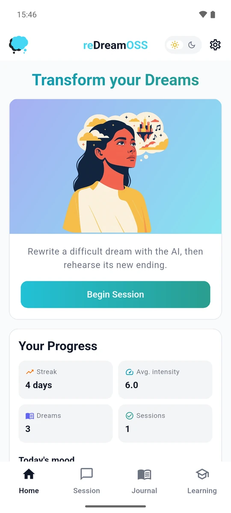
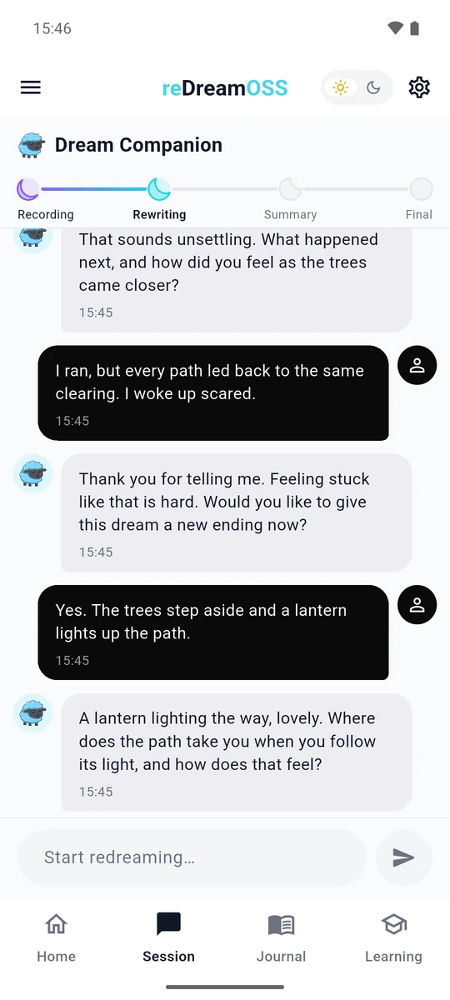
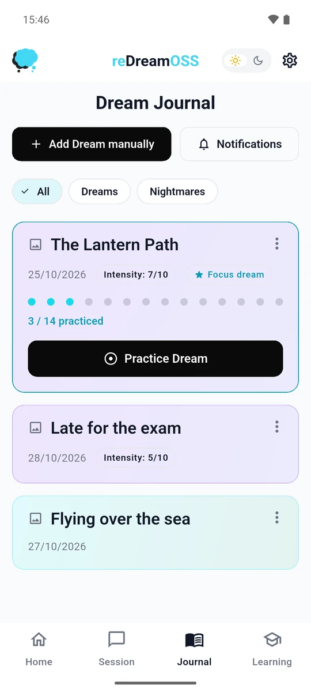
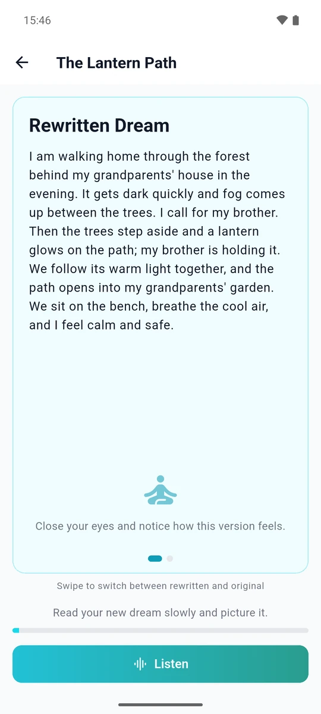

<h1 align="center">reDreamOSS</h1>
<h4 align="center">A self-help companion app against nightmares: record a dream, rewrite it, and rehearse — by reading or by listening.</h4>
<div align="center">

reDreamOSS is the open version of [reDreamAI](https://github.com/reDreamApp/reDreamAI): use any OpenAI-compatible LLM provider locally or on a small server ([ADR 0013](docs/decisions/0013-origin-of-redreamoss.md), [ADR 0014](docs/decisions/0014-personal-mode.md))

</div>

<br>
    
<p align="center">
  
  
  
  
</p>
<p align="center"><sub>Home · Session with the AI guide · Journal · Rewritten dream (example content)</sub></p>

<br>*reDreamAI does not diagnose or treat any condition. If you have PTSD or chronic nightmares, please talk to a doctor or psychotherapist.*<br>

## For yourself, on your computer

You need [uv](https://docs.astral.sh/uv/) and an API key for an OpenAI-compatible model provider.

```bash
git clone https://github.com/reDreamApp/reDreamOSS && cd reDreamOSS
make start        # first run: creates .env, then stops
# fill in LLM_BASE_URL, LLM_API_KEY, LLM_MODEL and LLM_SMALL_MODEL in .env
#   (STT_*/TTS_* for voice; .env.example has Mistral and Scaleway examples)
make start        # opens http://localhost:8000 in your browser
```

Without make: `uv run --project apps/server python scripts/start.py`. It fetches the web app for this version from the release (a checkout without one builds it, which needs [Flutter](https://docs.flutter.dev/get-started/install)), keeps everything in `apps/server/data/` (a SQLite file, the rehearsal audio and a sign-in key) and answers only this computer: no account, no password. The browser it opens carries the key in its address; for another browser, open the link it prints. Your texts go to the model provider you chose and nowhere else.

## For others, on a server

```
Android / iOS app ──HTTPS──► server (one container) ──► your model provider (OpenAI-compatible)
  asks for the server         login · chats · dreams       chat, crisis check, optional
  address once                consent · crisis check       speech-to-text and text-to-speech
                              rehearsal MP3s on a volume
                              Postgres (second container), optional Caddy for HTTPS
```

- **Run a server:** [docs/SELF_HOSTING.md](docs/SELF_HOSTING.md). A Linux box with Docker, a model provider's API key, about fifteen minutes.
- **Use the app:** install the APK from the [latest release](https://github.com/reDreamApp/reDreamOSS/releases/latest), enter the server address you were given, sign up with the invite code. Release builds only talk https.
- **Work on the code:** [docs/LOCAL_TESTING.md](docs/LOCAL_TESTING.md), then [RELEASING.md](RELEASING.md).

## Repository layout

```
apps/
  server/      Python FastAPI, one process: redream_api (users, chats, dreams, consent; source of truth)
               + redream_ai (guided chat, crisis check, speech), called in-process
    migrations/  the Postgres schema as numbered SQL files, applied by the server at start
  app/         Flutter (version pinned in apps/app/.fvmrc): Android, iOS and web client, EN + DE

compose.yaml   the whole stack on one box: Postgres + the server, optional Caddy (profile "caddy")
.env.example   every server setting, documented; scripts/init-env.sh turns it into .env
deploy/        Caddyfile for the caddy profile
scripts/       start.py: `make start` (personal mode); init-env.sh: .env for a server
docs/          self-hosting, local testing, roadmap, decisions/ (ADRs)
```

## Quick start (a server for others)

```bash
git clone https://github.com/reDreamApp/reDreamOSS && cd reDreamOSS
sh scripts/init-env.sh     # .env with a database password and an invite code (printed)
# set LLM_BASE_URL, LLM_API_KEY, LLM_MODEL and LLM_SMALL_MODEL in .env
docker compose up -d --build --wait
```

The server listens on `127.0.0.1:8000`; put HTTPS in front of it (Caddy, a tunnel or your proxy) as [SELF_HOSTING.md](docs/SELF_HOSTING.md) explains, and read its section on your duties as the operator before you invite anyone.

## Development

```bash
make help                  # list everything
make db-migrate            # apply apps/server/migrations to DATABASE_URL (Postgres 16+; settings from .env)
make api-dev               # run the server locally on :8001
make app-run               # flutter run via FVM; the app asks for the server address on first start
make test                  # every test suite
```

## Decisions

Binding architectural decisions live in [`docs/decisions/`](docs/decisions/README.md). Key invariants:

- One plain Postgres (16+) on servers, a SQLite file in personal mode. The schema is `apps/server/migrations/*.sql`, applied by `python -m redream_api.db.migrate` before the server starts; the ORM models must match it (CI checks), and a later migration brings a SQLite step too.
- One server process; the AI side is stateless and in-process — every turn carries the full conversation.
- Structured output (JSON mode) for the dream summary. No string-matching of model prose.
- Self-help framing, never therapy (ADR 0004); `apps/app/test/wording_test.dart` checks every user-facing text.
- The crisis check runs before every guided turn; a flagged message gets the helpline text, not the model.
- Streaming chat end-to-end via SSE.
- Cost guard: invite-only sign-up by default and a per-user daily request cap (`DAILY_AI_REQUESTS_PER_USER`, default 100); set a spend limit at your provider too.

## License

Copyright 2026 Daniel Menzel, Katharina Lüth and Ramon Zacharias.<br>
Special thanks to our former contributors Mahsa Zand and Tjark Darius who helped to create reDreamAI!

Licensed under the [Apache License 2.0](LICENSE); see [NOTICE](NOTICE). Report security problems privately: [SECURITY.md](SECURITY.md).
